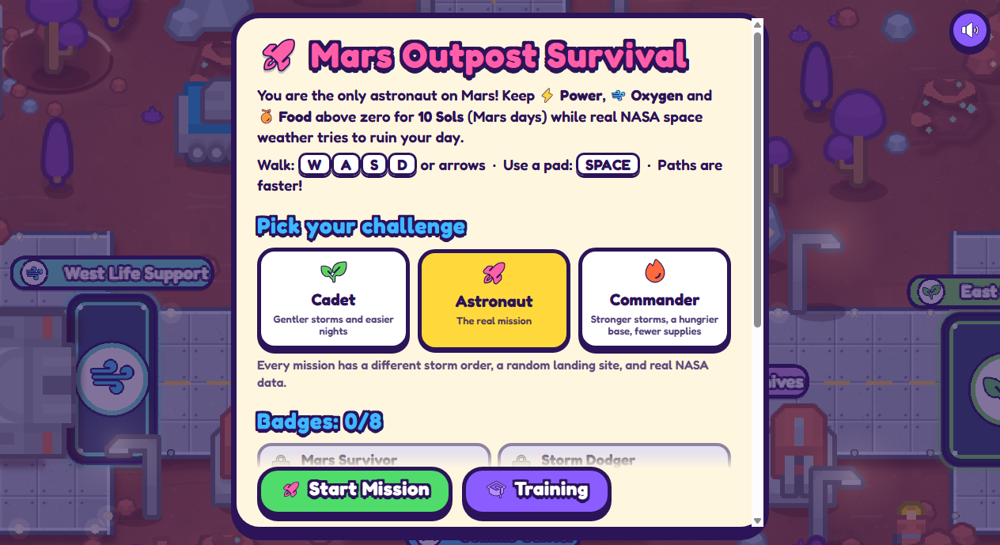
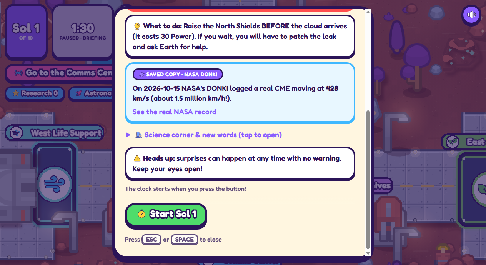
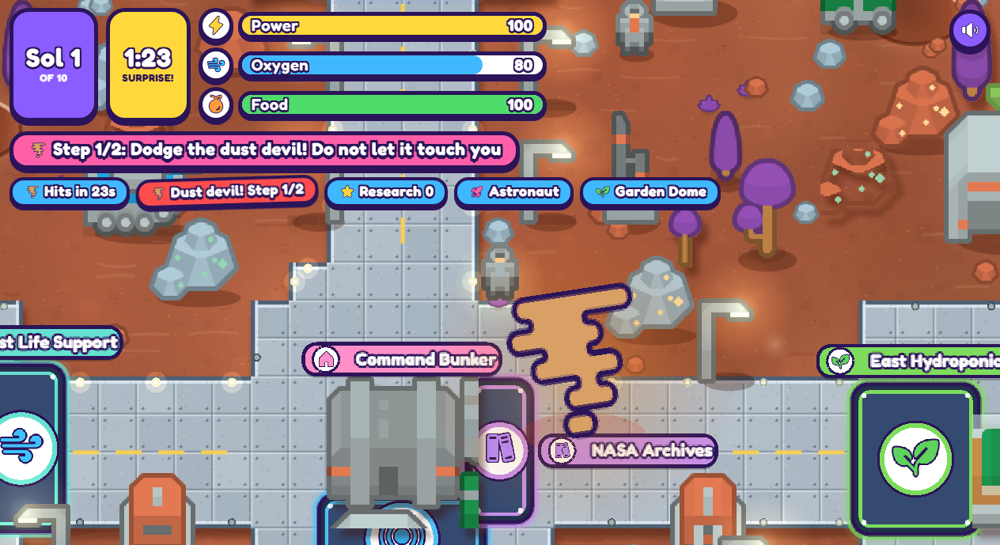
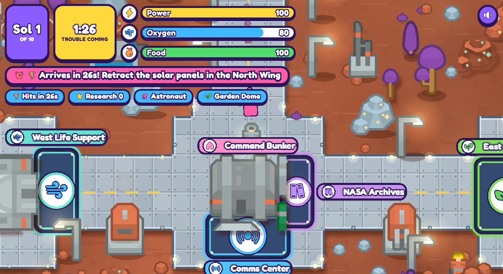
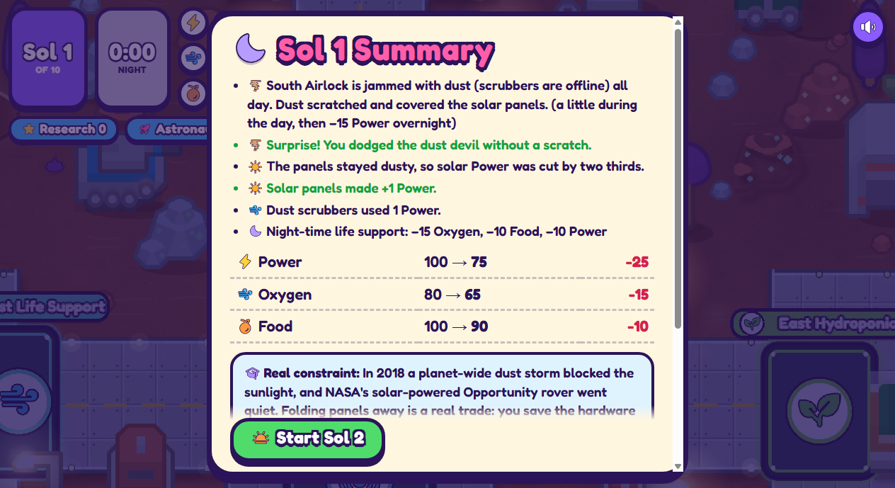

# Mars Outpost Survival

A 2D browser game for ages 7 to 12. You are the lone astronaut at a Mars outpost. Walk between rooms, use terminals, and survive 10 sols (Mars days) by trading Power, Oxygen and Food against each other while **real NASA space-weather data** (from the DONKI database) decides how hard each storm hits.

**Play it now in your browser: <https://pratasvaidya.github.io/NASAspaceappsgame/>** (works on computers, tablets and phones)



| A real NASA record in the morning briefing | Surprise: a dust devil rolls through the base |
|---|---|
|  |  |
| **The outpost** | **End of the Sol: what happened and the real science** |
|  |  |

## What kids learn (by doing, not reading)

- **Resources are a budget.** Every action has a price: shields cost Power, making oxygen costs Power, growing food costs Power *and* Oxygen. Nothing is free.
- **Space weather is real and measurable.** Each storm is scaled by a real NASA DONKI record (CME speed in km/s, geomagnetic Kp index, flare class), shown with its date and a link to the NASA page.
- **Prepare before the storm.** Shields only work if raised in advance, like real mission planning.
- **Mars is far away.** Asking Earth for help takes time (real messages take 6 to 44 minutes there and back), so you must keep things going yourself while you wait.
- **Plain words.** Every science word (sol, CME, Kp index, regolith, hydroponics...) is explained where it appears.

## Two-minute tour for judges

1. Open the game at <https://pratasvaidya.github.io/NASAspaceappsgame/> and press **Start Mission**. A guided training (under one minute, skippable) teaches the controls by doing.
2. Walk to the **Comms** pad (pink arrow) and read the briefing: look for the blue card with the **real NASA DONKI record** and its link.
3. Raise the **North Shields** before the countdown ends and watch the Power bar pay for it.
4. Want to see a surprise right away? Add `?surprise=devil` (or `leak`, `supply`, `science`) to the address.
5. Open the **NASA Archives** pad (next to the bunker) to see every dataset used, with attributions.

## Run it

**Online:** <https://pratasvaidya.github.io/NASAspaceappsgame/>

**On your own computer:** browsers block local files from loading each other, so use a tiny local server:

```
python -m http.server 8000
```

Then open <http://localhost:8000>. No account, no install, no build step. (It needs internet for Phaser and the Fredoka font, and for live NASA data. Without internet it still plays using a saved copy of real data.) It also works as a static site, for example on GitHub Pages.

**Controls:** WASD or arrow keys to walk (you run about 35% faster on the paved pathways), SPACE to use a pad. **Tap** SPACE to open a terminal; **hold** SPACE to patch a leak or do a job. **On a tablet or phone** an on-screen joystick and a big SPACE button appear automatically. Done with the day early? Once nothing needs protecting or fixing, a **Start Night Cycle** button appears in the HUD and at Comms (or press **N**) to skip the rest of the clock. Any surprise still due that Sol happens first, and the solar panels and scrubbers keep running for the skipped time, so it never helps or hurts your bars. Sound effects can be muted with the speaker button (top right).

**First time?** A guided training (it ends by itself before one minute, and you can skip it) shows the three big ideas by doing them: read the briefing at Comms, raise the shields and watch the Power bar drop (nothing is free), then hold SPACE to patch a broken pad. You can replay it from the title screen.

**NASA API key:** the game uses NASA's shared `DEMO_KEY`, which only allows a few requests per hour per network. Before a demo or a classroom session, get your own free key at <https://api.nasa.gov> and paste it into `NASA_API_KEY` at the top of `game.js` (or add `?key=YOUR_KEY` to the address). If NASA can't be reached, the game says so and uses a saved copy of real records.

## Why you will want to play again

- **Three challenges:** Cadet (gentler storms), Astronaut, Commander (stronger storms, a hungrier base, fewer supplies).
- **A new landing site every mission** (random twist): Sunny Plateau (more solar Power, less Food), Garden Dome (more Food from crops, less Oxygen), Shield Ridge (cheaper shields, less Power), Dusty Valley (scrubbers cost double, swept panels give more Power), or a Standard site.
- **Shuffled storms and real data:** the eight events come in a different order each mission, arrive at different times, and are scaled by a different real DONKI record each time. Storms also get 4% stronger every Sol.
- **Exploring off the paths (optional):** six hidden discoveries twinkle out on the open Martian dirt every mission. Walking onto one pauses the clock and shows a real thing NASA found on Mars (Opportunity's hematite "blueberries", Curiosity's sulfur crystals, Perseverance's leopard-spot rock, and more). They never change Power, Oxygen or Food and no arrow points at them, so they are never needed to win. They fill a Field Journal kept between missions (10 pages, shown on the title screen), count towards the Off-Road Explorer and Field Scientist badges, and add a few points.
- **Surprises with no warning:** the briefing tells you about the storm, but things also happen mid-Sol that nobody warned you about, and each one takes several steps (stand on a pad or spot and **hold SPACE** until the ring fills). **Disasters:** a **hull breach** (grab a patch kit at the Airlock, then patch the hole before it gets worse) and a **dust devil** (dodge the twister, then sweep the dusty solar panels clean). **Opportunities:** a **supply pod** (cargo cart from the Airlock, pry the pod open, then carry the heavy supplies to the right wing) and a **glowing rock** (sample kit, collect the rock, send it to Earth from Comms). Every calm Sol gets one, and about half of the storm Sols do, so raising shields is never the whole job. (Surprises are game design inspired by real events: micrometeoroid hits, Mars dust devils, cargo deliveries and rock sampling. They are not NASA data.)
- **Score and personal best** for each challenge, plus **eight badges** to collect (Storm Dodger, Fix-It Pro, Hull Hero, Treasure Hunter, Junior Scientist, Cool Under Pressure, Mars Survivor, Commander). Scores and badges are saved only in your own browser.


## The trade-offs (nothing is free)

| Where | Choice | Price |
|---|---|---|
| North Wing | Electromagnetic Shielding | −30 Power (21 at Shield Ridge). Only helps if raised **before** the storm arrives, and only against storms shields can stop. |
| North Wing | Retract solar panels (dust storms) | Saves the panels but you lose their Power (+0.15 Power per second) |
| East Wing | Crop Incubators | −20 Power, −15 Oxygen for +30 Food |
| West Wing | Oxygen Generator | −15 Power for +30 Oxygen |
| South Wing | Sweep Solar Panels (EVA) | −10 Oxygen for +30 Power |
| South Wing | Collect Rock Samples (research) | −15 Oxygen for +1 star of Research (no supplies) |
| South Wing | Dust Scrubbers | −0.1 Power per second. Off = dust slows your walking |
| Command Hub | Ask Earth for help | Takes 25 seconds (a real Mars–Earth round trip takes 6 to 44 minutes). You can't just wait: the broken system keeps leaking. |

Each Sol: briefing (clock paused) → 90 seconds of action → night (−15 Oxygen, −10 Food, −10 Power on Astronaut) → summary with a "real constraint" lesson. Lose if any resource hits 0. Win by finishing Sol 10. The end screen lists what your base actually lived through (for example "Deflected 2 Coronal Mass Ejections", "Patched 1 hull breach"), each with one sentence on how real NASA engineers handle that problem.

## NASA data used, and why

| Source | How it is used | Real or inspired? |
|---|---|---|
| **DONKI** (NASA CCMC space weather database), `api.nasa.gov/DONKI/CME`, `/GST`, `/FLR`, `/SEP` | On start the game requests the last 30 days of records. A real record is picked for that day's event and its real strength scales the damage: CME speed (km/s), geomagnetic storm Kp, flare class. The briefing shows the real date, value and a link to the NASA record. | **Real data** |
| **OSDR** (NASA Open Science Data Repository) | Plant radiation and space microbe events and their science notes | Inspired by the kind of experiments it hosts (not live data) |
| **NASA Mars exploration / Artemis** | Sol length, 3 to 22 minute Earth–Mars signal delay, 2018 dust storm and Opportunity, radiation shelters, power budgets | Facts and inspiration (not live data) |

The title screen and the NASA Archives terminal always say whether the DONKI data is **LIVE**, a **SAVED COPY** from this browser's cache (6 hour cache), or a **saved sample** of real records downloaded on 14 Nov 2026 (used only if NASA can't be reached). We never present saved data as live.

Notes:
- For demos you can force a surprise early with `?surprise=leak`, `?surprise=devil`, `?surprise=supply` or `?surprise=science` added to the address.
- If the graphics look broken on an old computer, open the game with `?canvas` added to the address (for example `http://localhost:8000/?canvas`) to use the simpler renderer.
- The flare endpoint (`/DONKI/FLR`) was returning an error when this was built. The game handles that and just uses the other record types.
- Results from NASA are cached in the browser for 6 hours, so reloading does not use up requests.
- Damage amounts, event timing and balance numbers are game design, not NASA measurements.

## Look and feel
Accessible by design: big bubble text, every icon has a word next to it, touch controls, a mute button, and calmer animations for players whose device asks for reduced motion. All pictures in the menus and on the map are icons (no emoji). The world is painted at start-up from Kenney's sprites plus code-drawn pavement, shadows, craters, ice, lamps and drifting dust. At night the base is tinted blue and the lamps glow; in a dust storm the screen turns dusty orange and the whole base shakes when a storm hits.

## Credits
Kenney "Sci-Fi RTS" (CC0), Phosphor Icons (MIT), Phaser 3 (MIT), Fredoka font (SIL OFL).

## Files
`index.html`, `style.css`, `game.js` (the game), `scenery.js` (paints the map), `icons.js` (the icon set), `docs/screenshots/`, `nasa_events.json` (event stories, glossary, attributions, saved sample data), `assets/`.
